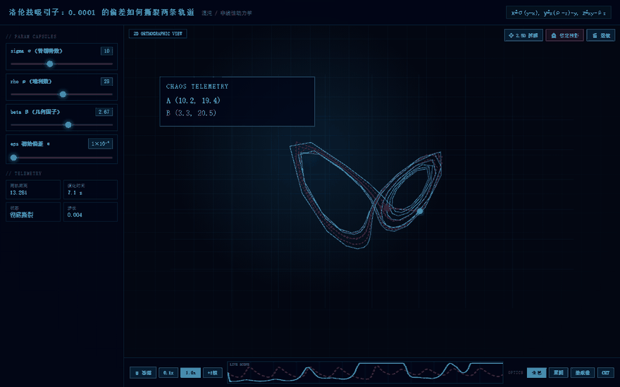

<div align="center">

# SciCanvas

### Turn Any Textbook Paragraph or Paper into a Playable 2D Lab

⏱ **10 秒出科学蓝图 · 实测 25–30 秒出可玩沙盒**（双 Agent 串行生成，复杂概念略久）

> 📁 本目录是 **A 方案（自由生成）**。另一条路线见 [`../B-模板化生成/`](../B-模板化生成/README.md)——约 4 秒出结果，但只覆盖已建模板的概念。

[](https://github.com/your-username/SciCanvas/stargazers)
[](https://github.com/deepseek-ai/deepseek-harness)
[](./LICENSE)

**English** | [简体中文](#简体中文说明) | [Live Demo](#demo-showcase) | [Quick Start](#quick-start)

<br/>



</div>

## Why SciCanvas?

Reading static math formulas and dense arXiv papers is painful. Inspired by **3Blue1Brown** and Bret Victor's *Explorable Explanations*, **SciCanvas** uses a self-healing dual-agent pipeline powered by **DeepSeek** and **DeepSeek Harness (`dsh`)** to transform any scientific text into a draggable, 60fps HTML5 Canvas/SVG laboratory on the fly.

| Traditional AI Chatbots | **SciCanvas** |
| :--- | :--- |
| Dumps walls of static LaTeX equations | Generates **live 60fps interactive 2D simulations** |
| Passive reading with low retention | **"What-If" Intuition Challenges** with real-time sliders |
| Broken code snippets you have to copy-paste | **Self-Healing Sandbox** auto-fixes runtime JS errors |
| Locked inside a platform | **1-Click Export** to a standalone ~15KB `.html` flashcard |

## Key Features

- **Dual-Agent Science Pipeline**: **Planner Agent** extracts governing equations, boundary conditions, and parameter ranges; **Coder Agent** compiles them into a zero-dependency interactive canvas.
- **Self-Healing Generative UI**: Built-in sandbox error listener (`window.onerror` bridge) automatically catches runtime glitches and patches the code transparently (capped at 2 retries per artifact).
- **DeepSeek Harness (`dsh`) Native**: Works both as a standalone Next.js + FastAPI web studio and as a composable **Cordis Plugin** inside `dsh`.
- **Shareable Single-File Artifacts**: Export any generated experiment into a single `.html` file that runs offline in any browser or embeds cleanly into Notion.

## Quick Start

### 1. Clone & Configure Backend

```bash
git clone https://github.com/your-username/SciCanvas.git
cd SciCanvas/A-自由生成/backend
pip install -r requirements.txt
cp .env.example .env          # Windows: copy .env.example .env
# Add your DEEPSEEK_API_KEY inside .env
uvicorn main:app --reload --port 8010
```

### 2. Launch Frontend Studio

```bash
cd ../frontend
npm install
npm run dev
```

Open <http://localhost:3000> and click any preset experiment or type your own concept.

> The frontend reads `NEXT_PUBLIC_API_BASE` (default `http://127.0.0.1:8010`).
> If you change it, update `ALLOWED_ORIGINS` in `backend/.env` as well.

### 3. Try the Zero-Install Gallery

`gallery/` is a static site: open `gallery/index.html` directly, or push it to GitHub Pages via the bundled workflow.

## Architecture

```
Browser ──► Next.js studio (page.tsx)
                │  POST /api/generate
                ▼
           FastAPI (main.py)
                │
        ┌───────┴────────┐
        ▼                ▼
  Planner Agent     Coder Agent        ← prompts.py
  (concept→JSON)    (JSON→single HTML)
        │                │
        └───────┬────────┘
                ▼
        iframe srcdoc  ──window.onerror──►  POST /api/fix  ──►  Fixer Agent
                                                  ▲                  │
                                                  └──── new html ◄───┘
```

## Use as a DeepSeek Harness (`dsh`) Plugin

```bash
cd A-自由生成/dsh-plugin-scicanvas
npm install
npm run build          # -> lib/index.js
# then mount lib/ in your dsh workspace via cordis.yml
```

The plugin exposes two tools:

| Tool | Purpose |
| :--- | :--- |
| `render_science_lab` | concept/paper → single-file interactive HTML lab |
| `heal_science_lab` | broken lab + error message → patched lab |

It is **dual-mode**: it probes a local FastAPI backend first (`/api/health`, 2.5s timeout) and falls back to calling DeepSeek directly with `DEEPSEEK_API_KEY`.

> ⚠️ The Cordis tool-registration entry point is version-dependent. Validate against your installed `dsh` before publishing to npm — see `docs/技术可行性评估.md`.

## Roadmap

- [x] Dual-Agent (Planner + Coder) 2D Canvas/SVG generation
- [x] Automatic runtime error self-healing loop
- [x] One-click standalone HTML lab export
- [ ] Direct arXiv PDF URL parsing & multi-figure interactive breakdown
- [ ] Three.js / WebGL 3D field & molecular visualization mode
- [ ] Community Lab Gallery for sharing & remixing experiments

## Demo Showcase

| Experiment | File |
| :--- | :--- |
| 多普勒效应与马赫锥音爆临界仿真 | `gallery/labs/doppler-sonic-boom.html` |
| 多普勒（双 Agent 实时生成版） | `gallery/labs/doppler-agentic.html` |
| 动量梯度下降 | `gallery/labs/gradient-descent.html` |
| 双星引力弹弓 | `gallery/labs/binary-star-slingshot.html` |
| 弹簧振子（dsh 插件生成） | `gallery/labs/spring-oscillator.html` |

`../assets/demo.gif` 由 `tools/capture-frames.mjs`（真实 Chrome 截帧）+ `tools/build-assets.py`（合成）产出，
改了模板或 UI 后重新跑这两步即可更新。

## 简体中文说明

**SciCanvas** 把课本段落、公式或论文摘要，在 10 秒内变成可拖拽参数、带实时数值的 2D 互动实验沙盒。

- **双 Agent 流水线**：Planner 拆出物理量与参数区间 → Coder 生成零依赖单文件 HTML。
- **自愈沙盒**：页面里的 `window.onerror` 会把报错回传给后端，Fixer Agent 自动打补丁重渲染。
- **一键导出**：生成结果可下载为单个 `.html`，离线可用、可直接嵌进 Notion。
- **即开即玩**：`gallery/` 是纯静态展厅，无需部署后端。

## License

Released under the MIT License. Built with ❤️ for curious minds everywhere.