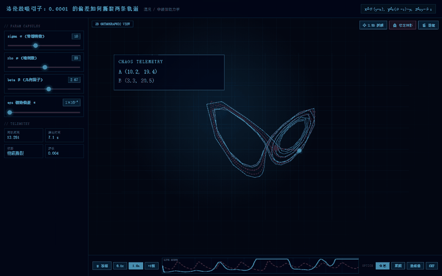
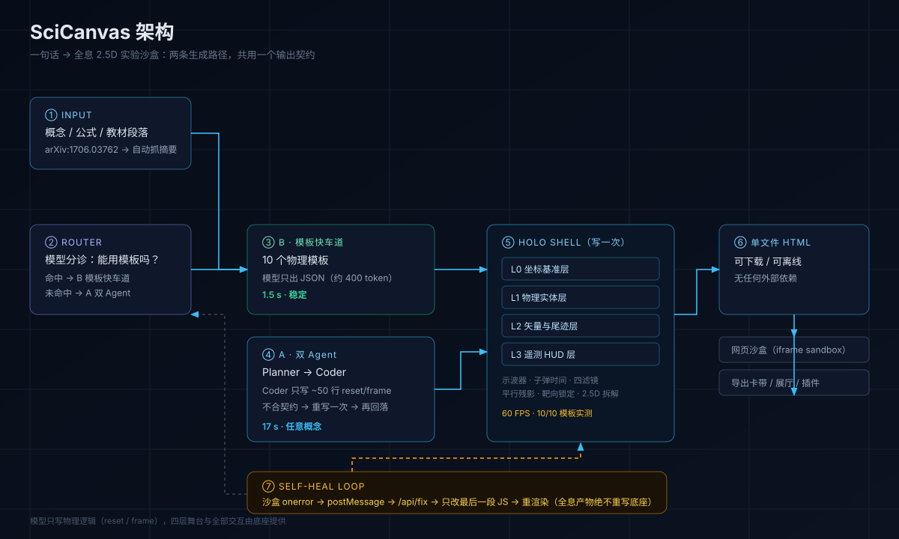

# SciCanvas

把课本段落、公式或论文摘要，变成可拖拽参数、带实时数值的 2D 互动实验沙盒。

<p align="center">
  
</p>

<p align="center">
  <em>上面每一个画面都是真实生成的产物，没有一张是设计稿</em>
</p>

本仓库同时存放**两条技术路线**——A 方案已实现可跑，B 方案是已验证思路的原型骨架。

---

## 架构

<p align="center">
  
</p>

两条生成路径共用一个输出契约：**单文件 HTML**。所以模板引擎和双 Agent 可以随时互相兜底，
产物也天然可下载、可离线、可塞进 iframe 沙盒。

---

## 两条路线

| | **A · 自由生成** ✅ 已实现 | **B · 模板化生成** 🧪 原型 |
| :--- | :--- | :--- |
| **怎么做** | 双 Agent：Planner 拆解物理量 → Coder 直接写整份单文件 HTML | 预置参数化模板库；模型只输出「用哪个模板 + 参数 + 文案」 |
| **模型输出量** | 约 6,900 tokens（500–700 行代码） | 约 300–500 tokens（一段 JSON） |
| **实测耗时** | **25–30 秒**（5 次实测） | 目标 **10–15 秒** |
| **覆盖面** | 任意概念，想生成什么就生成什么 | 10 类预置仿真（力学/波动/电磁/天体/混沌/数学/电路/热学/概率） |
| **质量稳定性** | 取决于模型，需抽检物理正确性 | 模板内物理必然正确，不会跑偏 |
| **可维护性** | 改 prompt 即改行为，难调试 | 改模板即改质量，可单元测试 |
| **代码量** | 后端 + 前端 + 插件 + 展厅，完整产品 | 1 个生成器 + N 个模板 |
| **适用场景** | 对外 Demo、冲 GitHub、任意概念 | 教学产品化、批量生成、离线部署 |

> **为什么两个都要**：A 负责"什么都能试"的惊艳感，B 负责"每次都对"的可靠性。
> A 现在就能发布；B 是把 A 的随机性兜住的后手。

---

## 目录

```
D:\SciCanvas\
├── A-自由生成\                 ← 主方案，完整可运行
│   ├── backend\                FastAPI + 双 Agent（Planner / Coder / Fixer）
│   ├── frontend\               Next.js 15 工作台（进度条 / 沙盒 / 自愈 / 导出）
│   ├── dsh-plugin-scicanvas\   DeepSeek Harness 插件
│   ├── gallery\                免服务器静态展厅（4 个真实实验）
│   ├── assets\                 README 演示素材
│   ├── cordis.yml              插件挂载配置
│   └── README.md               A 方案详细说明
├── B-模板化生成\               ← 第二方案，原型
│   ├── generator.py            plan(JSON) → 单文件 HTML
│   ├── templates\              参数化模板库
│   ├── examples\               示例 plan
│   └── README.md               B 方案规格与用法
├── docs\
│   └── 技术可行性评估.md        实测数据、风险清单、成本、剩余工作量
├── .github\workflows\          GitHub Pages 自动部署（指向 A 的 gallery）
├── LICENSE  .gitignore  .gitattributes
└── README.md                   本文件
```

---

## 快速开始（A 方案）

```bash
cd A-自由生成/backend
pip install -r requirements.txt
cp .env.example .env        # 填入 DEEPSEEK_API_KEY
uvicorn main:app --reload --port 8010
```

> **默认端口是 8010，不是 8000**。实测本机 8000 端口会被外部软件（防火墙/杀软）拖慢，
> SSE 首帧要等 1–3 秒；同代码在 8002/8003/8010/8021 上首帧只要 2–7 毫秒。
> 这与 uvicorn 的 `--http` 实现无关，换端口即可。
>
> 必须换回去时：改 `A-自由生成/frontend/src/app/page.tsx` 的 `API_BASE`、
> `backend/start|stop_backend.cmd` 的 `PORT`、`cordis.yml` 的 `backendUrl`，四处要一致。

```bash
cd A-自由生成/frontend
npm install
npm run dev                 # http://localhost:3000
```

**不想装环境？** 直接双击 `A-自由生成/gallery/index.html`，5 个预生成实验立刻可玩；
或运行 `A-自由生成/gallery/start_gallery.cmd` 起本地静态服务（推荐，manifest 才能正常加载）。

---

## 快速试玩（B 方案）

```bash
cd B-模板化生成
python generator.py --list                                  # 看可用模板
python generator.py --plan examples/plan-oscillator.json     # 模板 → HTML
python generator.py --text "演示单摆阻尼振动" --out out/demo.html   # 调模型选模板
```

---

## 特性

| 特性 | 一句话 |
| :--- | :--- |
| **双 Agent 生成** | Planner 拆物理量 → Coder 写单文件 HTML → Fixer 兜底修 Bug |
| **自愈沙盒** | 运行时 `window.onerror` 回传后端，自动打补丁并重渲染（同产物最多 2 次） |
| **先猜后试** | 挑战卡先让你押一个预测，再拖滑块验证——不是拖着玩，是想完再玩 |
| **双沙盒同屏** | 两块独立 iframe 跑同一份代码，左右分别调参对比（可同步重置） |
| **混合路由** | 模板命中 ≈2 秒，未命中回落双 Agent ≈25 秒 |
| **流式进度** | 分诊 / Planner / Coder 阶段实时推送，长任务每 3 秒心跳 |
| **结果缓存** | 同一提示词再点一次：0 token、0.04 秒；`/api/cache` 可查看与清空 |
| **可取消 / 不丢稿** | 生成可随时取消，刷新页面自动恢复上次实验 |
| **一键导出** | 任意实验都能下成单个 `.html`，离线可用、可嵌 Notion |
| **dsh 原生插件** | `render_science_lab` / `heal_science_lab`，生成即登记展厅 |

---

## 回归测试

```bash
node tests/run-all.mjs          # 全量（约 2 分钟）
node tests/run-all.mjs --fast   # 只跑不花钱的快速项
node tests/run-all.mjs --only 04
```

七个用例覆盖：后端冒烟、插件契约、混合路由、模板渲染、自愈链路、前端徽标、交互功能、展厅一致性。
缺环境的用例会自动 SKIP 而不是误报失败。详见 [tests/README](tests/README.md)。

---

## 当前状态

| 模块 | 状态 |
| :--- | :--- |
| A · 双 Agent 生成 | ✅ 多次真实调用全部成功，产物可运行 |
| A · 前端工作台 | ✅ 进度条 / 引擎徽标 / 先猜后试 / 双沙盒对比 |
| A · 静态展厅 | ✅ 5 个实验（4 个由模型现场生成） |
| A · 自愈闭环 | ✅ 真实 Chrome 端到端验证：报错 → /api/fix → 重渲染 |
| A · dsh 插件 | ✅ 已安装进 desktop profile，生成即登记展厅 |
| 混合路由 | ✅ 模板命中 1.3–2.1s，未命中回落 20–30s |
| B · 生成器 + 模板 | ✅ 10 个模板，真实浏览器逐页验证 |

细节与证据见 [技术可行性评估](docs/技术可行性评估.md)，开发进度见 [执行清单](docs/执行清单.md)。

---

## 参与

提交前请跑一次 `node tests/run-all.mjs --fast`；分支约定与代码风格见 [CONTRIBUTING](CONTRIBUTING.md)，
版本变化见 [CHANGELOG](CHANGELOG.md)。