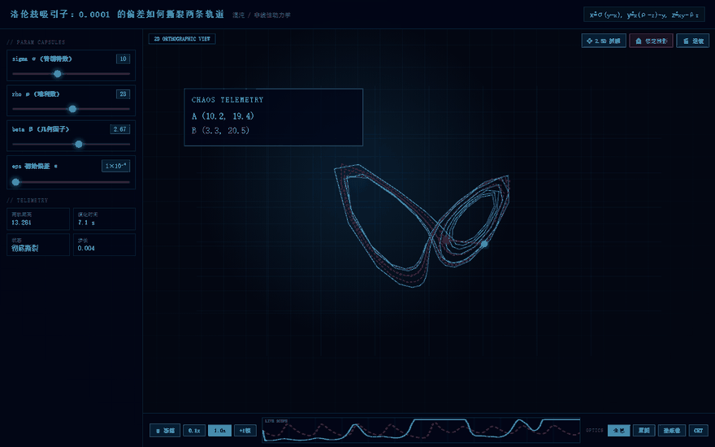
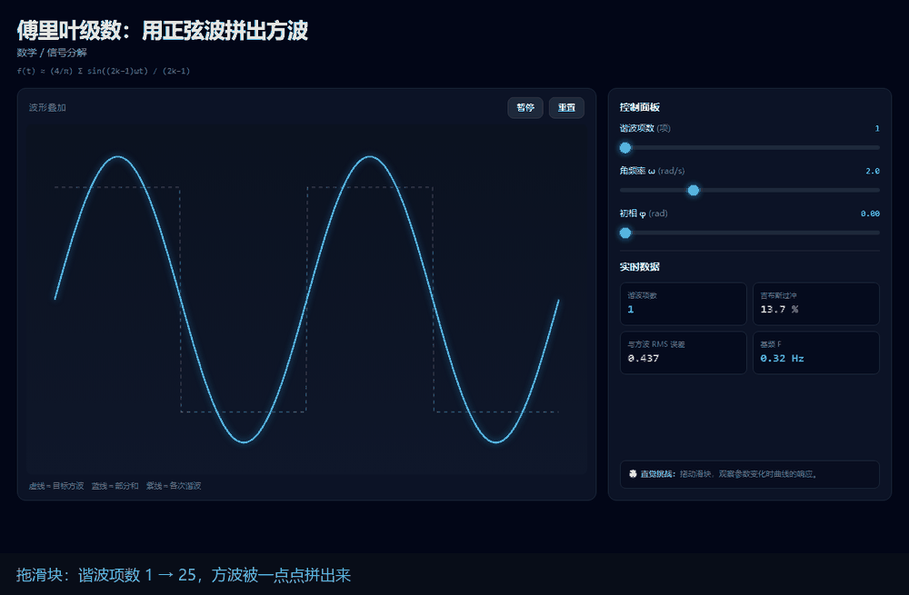
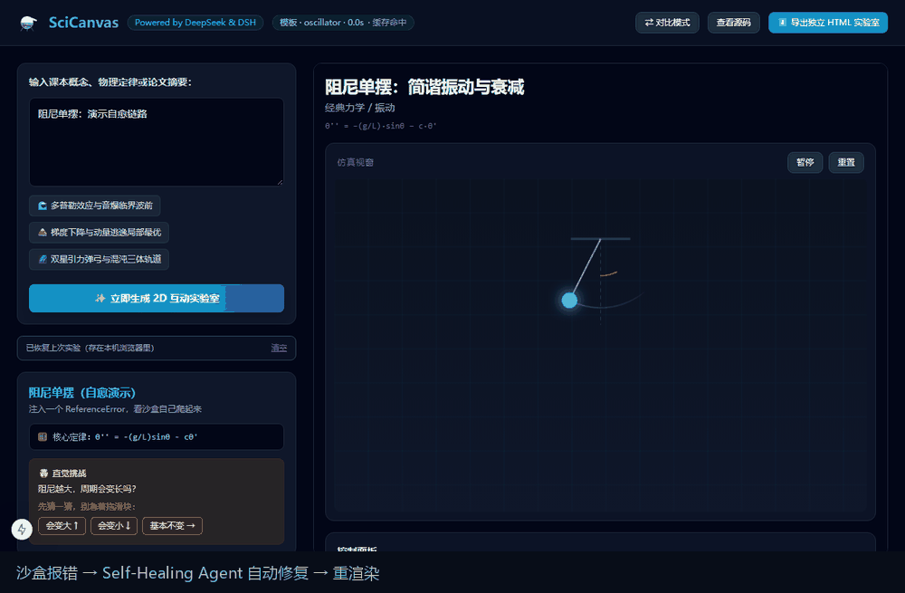
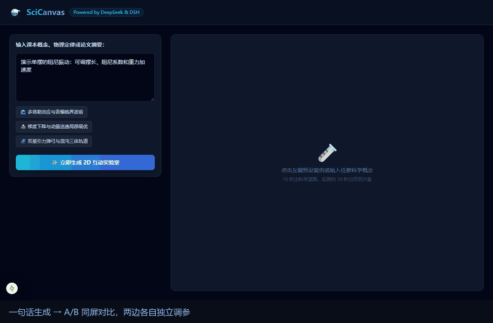
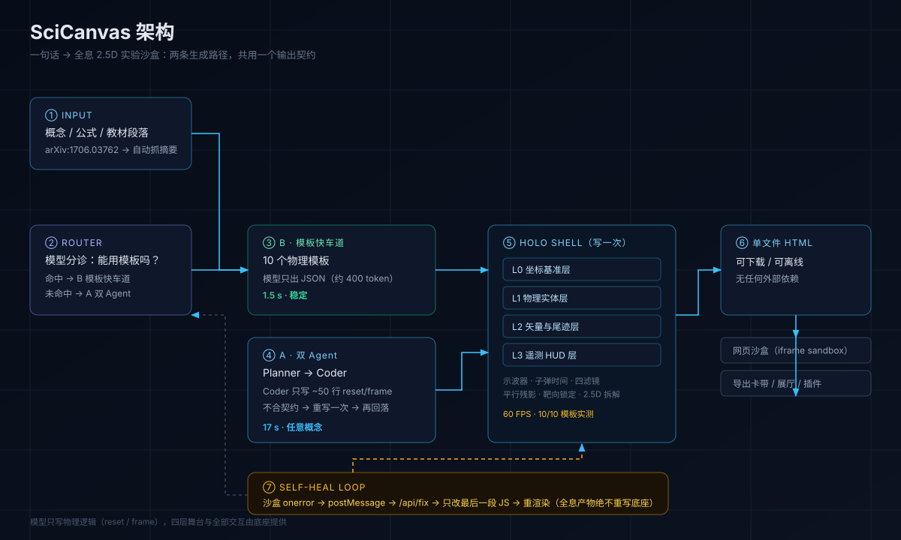

# SciCanvas

> **English → [README.md](./README.md)**


把课本段落、公式或论文摘要，变成可拖拽参数、带实时数值的 2D 互动实验沙盒。

<p align="center">
  
</p>

<p align="center">
  <em>上面每一个画面都是真实生成的产物，没有一张是设计稿</em>
</p>

## 三段真实交互

三张 GIF 都是脚本驱动真实 Chrome 录的，不是后期剪辑。

<table>
<tr>
<td width="33%" align="center">
  <br />
  <sub><b>① 拖滑块看数学成形</b><br />谐波项数 1 → 25，吉布斯振铃自己长出来</sub>
</td>
<td width="33%" align="center">
  <br />
  <sub><b>② 报错了自己爬起来</b><br />沙盒抛异常 → 自动修复 → 重渲染，用户不用刷新</sub>
</td>
<td width="33%" align="center">
  <br />
  <sub><b>③ 一句话生成 + A/B 对比</b><br />两边独立调参，适合讲清"改哪个参数会怎样"</sub>
</td>
</tr>
</table>

复现方法：`node tools/capture-interactions.mjs` 截帧 → `python tools/build-demo-gifs.py` 合成。

**一条流水线，两种生成策略**：先问模型「这个能用模板吗」，命中就套模板（1.5 s），
没命中就让双 Agent 现场写（17 s）。两条路径的产品是同一种东西——单文件 HTML，
里面是同一个全息底座。

---

## 架构

<p align="center">
  
</p>

两条生成路径共用一个输出契约：**单文件 HTML**。所以模板引擎和双 Agent 可以随时互相兜底，
产物也天然可下载、可离线、可塞进 iframe 沙盒。

## 全息 2.5D 底座

产物不再是"一大块 canvas"，而是一个写死的外壳 + 一小段物理逻辑：

```
holo_shell（写一次，所有实验共用）        模型 / 模板作者只写这些
├─ L0 坐标基准层  ┐                      function reset() { ... }   // 参数变了重画静态层
├─ L1 物理实体层  ├ 四层 SVG，可 2.5D 拆解   function frame(dt) { ... }  // 每帧物理 + 绘制
├─ L2 矢量尾迹层  │  残影 / 靶向准星挂在上面   HOLO.L0..L3(html)  HOLO.telemetry(a,b)
└─ L3 遥测 HUD 层 ┘                      HOLO.metric(id, text)
   示波器 · 子弹时间 · 四套滤镜 · 自动运镜
```

双 Agent 路径的 Coder 因此从"写 600 行 HTML"变成"写 50 行 JS"，端到端从 **25–30 s 降到 17 s**；
片段不合格（混进 HTML、漏了 `window.frame`、还在用 canvas……）会自动回落到老的整份生成。
详细契约见 [`docs/HOLO_TEMPLATE_GUIDE.md`](./docs/HOLO_TEMPLATE_GUIDE.md)。

---

## 一条流水线，两种策略

| | **模板路径**（快） | **双 Agent 路径**（万能） |
| :--- | :--- | :--- |
| **怎么做** | 模型只判断「属于哪个模板」，物理代码是人写的 | Planner 拆物理量 → Coder 只写 ~50 行 `reset/frame` |
| **模型输出量** | 约 400 tokens（一段 JSON） | 约 50 行 JS（原先要写 600 行 HTML） |
| **实测耗时** | **1.5 s** | **17 s**（改造前 25–30 s） |
| **覆盖面** | 10 类预置仿真 | 任意概念 |
| **质量稳定性** | 模板内物理必然正确 | 取决于模型，有校验→重写→回落三层保护 |
| **适用场景** | 高频概念、课堂演示 | 长尾概念、论文、冷门公式 |

两条路径产出的都是**同一种产物**（单文件 HTML + 全息底座），所以可以互相兜底：
模板没命中就自动走 Agent，Agent 片段不合格就重写一次，还不行才回落到"模型写整份 HTML"。

---

## 目录

```
D:\SciCanvas\
├── backend\                     FastAPI：分流 · 双 Agent · 模板 · 全息底座
│   ├── main.py  router.py       API 入口与分流
│   ├── agents.py                Planner / Coder / Fixer
│   ├── holo_build.py            50 行 JS 的校验与拼装
│   ├── generator.py             模板路径：JSON → 单文件 HTML（含 CLI）
│   ├── shell/holo_shell.py      全息 2.5D 底座（四层 SVG / 示波器 / 滤镜 / 残影）
│   ├── templates/               10 个参数化模板
│   ├── cache.py  arxiv.py       结果缓存、arXiv 摘要直读
│   └── smoke_test.py            离线冒烟（不需要 Key）
├── frontend\                    Next.js 15 工作台（进度 / 沙盒 / 自愈 / 导出）
├── gallery\                     免服务器静态展厅（5 个真实实验）
├── plugins/dsh-plugin-scicanvas DeepSeek Harness 插件
├── tools\                       截帧、合成 GIF、构建素材
├── tests\                       10 个回归用例
├── docs\                        技术可行性评估 · 执行清单 · 全息模板手册
├── assets\                      README 素材
├── cordis.yml                   插件挂载配置
└── README.md                    本文件
```

---

## 快速开始

```bash
cd backend
pip install -r requirements.txt
cp .env.example .env        # 填入 DEEPSEEK_API_KEY
uvicorn main:app --reload --port 8010
```

> **默认端口是 8010，不是 8000**。实测本机 8000 端口会被外部软件（防火墙/杀软）拖慢，
> SSE 首帧要等 1–3 秒；同代码在 8002/8003/8010/8021 上首帧只要 2–7 毫秒。
> 这与 uvicorn 的 `--http` 实现无关，换端口即可。
>
> 必须换回去时：改 `frontend/src/app/page.tsx` 的 `API_BASE`、
> `backend/start|stop_backend.cmd` 的 `PORT`、`cordis.yml` 的 `backendUrl`，四处要一致。

```bash
cd frontend
npm install
npm run dev                 # http://localhost:3000
```

**不想装环境？** 直接双击 `gallery/index.html`，5 个预生成实验立刻可玩；
或运行 `gallery/start_gallery.cmd` 起本地静态服务（推荐，manifest 才能正常加载）。

---

## 只用模板，不开前端

```bash
cd backend
python generator.py --list                                   # 看可用模板与参数区间
python generator.py --plan examples/plan-oscillator.json      # plan(JSON) → HTML
python generator.py --template fourier --out out/f.html        # 直接指定模板
python generator.py --text "演示单摆阻尼振动" --out out/demo.html   # 让模型选模板
```

---

## 特性

| 特性 | 一句话 |
| :--- | :--- |
| **双 Agent 生成** | Planner 拆物理量 → Coder 写单文件 HTML → Fixer 兜底修 Bug |
| **自愈沙盒** | 运行时 `window.onerror` 回传后端，自动打补丁并重渲染（同产物最多 2 次） |
| **先猜后试** | 挑战卡先让你押一个预测，再拖滑块验证——不是拖着玩，是想完再玩 |
| **双沙盒同屏** | 两块独立 iframe 跑同一份代码，左右分别调参对比（可同步重置） |
| **混合路由** | 模板命中 ≈2 秒，未命中回落双 Agent ≈25 秒 |
| **流式进度** | 分诊 / Planner / Coder 阶段实时推送，长任务每 3 秒心跳 |
| **结果缓存** | 同一提示词再点一次：0 token、0.04 秒；`/api/cache` 可查看与清空 |
| **arXiv 直读** | 直接贴 `arXiv:1706.03762`，后端自动抓标题与摘要再生成，不用手抄正文 |
| **公式排版** | KaTeX 渲染核心定律，`Vc(t)=V₀(1−e^{−t/τ})` 不再是等宽字符串 |
| **全息 2.5D** | 四层 SVG 舞台（基准/实体/矢量/遥测）、示波器、子弹时间、四滤镜、平行残影、混沌注入 |
| **可取消 / 不丢稿** | 生成可随时取消，刷新页面自动恢复上次实验 |
| **一键导出** | 任意实验都能下成单个 `.html`，离线可用、可嵌 Notion |
| **dsh 原生插件** | `render_science_lab` / `heal_science_lab`，生成即登记展厅 |

---

## 回归测试

```bash
node tests/run-all.mjs          # 全量（约 2 分钟）
node tests/run-all.mjs --fast   # 只跑不花钱的快速项
node tests/run-all.mjs --only 04
```

七个用例覆盖：后端冒烟、插件契约、混合路由、模板渲染、自愈链路、前端徽标、交互功能、展厅一致性。
缺环境的用例会自动 SKIP 而不是误报失败。详见 [tests/README](tests/README.md)。

---

## 当前状态

| 模块 | 状态 |
| :--- | :--- |
| 双 Agent 生成 | ✅ 多次真实调用全部成功，产物可运行 |
| 模板库 | ✅ 10 个模板，真实浏览器逐页验证，均 60 FPS |
| 分流 | ✅ 模板命中 1.5 s，未命中回落 17 s |
| 前端工作台 | ✅ 进度条 / 引擎徽标 / 先猜后试 / 双沙盒对比 / 全息座舱 |
| 自愈闭环 | ✅ 真实 Chrome 端到端：报错 → /api/fix → 只改 JS → 重渲染 |
| 静态展厅 | ✅ 5 个实验，全部全息版 |
| dsh 插件 | ✅ 已安装进 desktop profile，生成即登记展厅 |

细节与证据见 [技术可行性评估](docs/技术可行性评估.md)，开发进度见 [执行清单](docs/执行清单.md)。

---

## 参与

提交前请跑一次 `node tests/run-all.mjs --fast`；分支约定与代码风格见 [CONTRIBUTING](CONTRIBUTING.md)，
版本变化见 [CHANGELOG](CHANGELOG.md)。